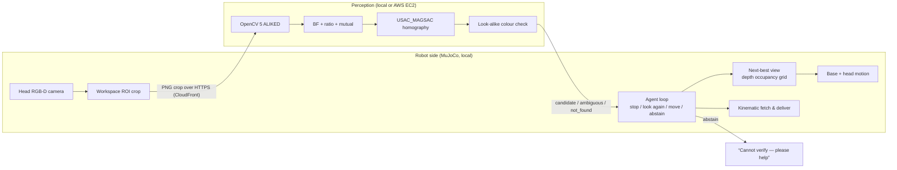

# CareMate — find, check and fetch with OpenCV 5 (simulation)

CareMate is a simulated assistive robot (PAL TIAGo++ in MuJoCo) that is asked for an everyday item — *"bring me
my reading book"* — and has to **find it, check it is the right one, and bring it to the resident's table**.
Perception uses **OpenCV 5** (ALIKED features, USAC/MAGSAC homography) and can run locally or on an **AWS EC2**
service. When the robot cannot be sure, it **does not act**: it says *"Cannot verify — please help"*.

Entry for the OpenCV AI Competition 2026 (powered by AWS). Simulation only; see [Limitations](#limitations).

```
python -m caremate.demo_v0_7 --target crunch_peanut
```
1. The head camera looks at the table; OpenCV 5 matches the requested item against enrolled reference images.
2. A box that looks almost the same (another flavour, same brand) is rejected by a colour check.
3. Not sure yet → the agent picks the next viewpoint from a depth occupancy grid, drives there, looks again.
4. Clean match → target position from the OpenCV polygon + head depth → kinematic fetch → placed on the
   resident's table.

## How it works



| Part | File | What it does |
|---|---|---|
| Perception | `caremate/perception_v0_7.py` | ALIKED (`cv2.ALIKED_create`, ONNX via OpenCV 5 DNN) on native-scale 640 px tiles inside a workspace ROI; multi-face references; BF + ratio + mutual matching; USAC_MAGSAC homography gate; multi-instance search; Lab-chroma look-alike check. Output is `candidate`, `ambiguous`, `not_found` or `error` — never "verified". |
| Agent | `caremate/agent_loop_v0_7.py` | Policies `active` (next-best view), `tour`, `random`, `fixed`, `active_head`, `random_head`. Stops only on a clean candidate; writes `trace.json` for every step. |
| Next-best view | `caremate/nbv_v0_7.py` | Three collision-checked base stations; 3 cm voxel occupancy grid from head depth; expected-gain scoring. |
| Fetch | `caremate/fetch_v0_7.py` | Kinematic, scripted fetch-and-deliver (see below). |
| Enrolment | `caremate/enrol_v0_7.py` | Checks a new reference image for size, texture and look-alikes before staff add it. |
| Cloud service | `caremate/service/app.py`, `Dockerfile`, `deploy/` | FastAPI: `/v1/health`, `/v1/perceive`, `/v1/references`. |
| Remote client | `caremate/remote_backend.py` | Sends only the ROI crop; network failure → `error` → the agent abstains. |
| Evaluation | `caremate/eval_v0_7.py`, `caremate/bench_remote_v0_7.py` | Randomised paired episodes, McNemar tests; local vs AWS agreement and latency. |
| Demo | `caremate/demo_v0_7.py` | Viewer, live head camera, OpenCV overlay, mp4 recording with a robot-following camera. |

### OpenCV in CareMate
New in OpenCV 5:
- **ALIKED** learned keypoints and descriptors (`cv2.ALIKED_create`, `cv2.ALIKED_Params`), ONNX weights run by
  OpenCV itself, with no PyTorch.
- **LightGlue** matcher (`cv2.LightGlueMatcher_create`): integrated, but the reported results use the
  brute-force matcher (see Limitations).

Also used:
- **Matching and geometry:** `BFMatcher` (L2) with ratio test and mutual check, then `findHomography` with
  `USAC_MAGSAC`. `perspectiveTransform`, `isContourConvex`, `contourArea` and `intersectConvexConvex` reject
  implausible boxes and overlapping duplicates.
- **Look-alike check:** `warpPerspective` both ways, then `cvtColor(BGR2LAB)` chroma on the pixels where two
  references differ.
- **Workspace ROI masks and enrolment checks** (texture, a synthetic tilted view of the new photo): `fillPoly`,
  `erode`, `morphologyEx`, `Laplacian`, `GaussianBlur`, `getPerspectiveTransform`.
- **Service I/O:** `imdecode` / `imencode` (lossless PNG crop).

### Fetch and deliver (kinematic)
- Target position comes **only** from the OpenCV 5 support polygon and head depth — never from simulator object
  poses. A plane fit to the visible face gives the grasp direction; side grasp between the finger pads.
- Base: grid roadmap (turn on the spot, straight drives, reverse out). Arm: damped-least-squares IK within joint
  limits; the unfold path is precomputed (`caremate/data/unfold_right_v0_7.json`) and re-checked at run time.
- Collision checks use signed distances (`mj_geomDistance`) against furniture, the robot itself and the held
  object; every frame is audited and the result is written to `trace.json` (`execution_check`,
  `joint_limits_check`).
- The object is attached rigidly only when **both** fingers touch it. This is **not** physics grasping, and
  `grasp_authorised` stays `false`.

## Results (simulation, held-out seed 31, 100 episodes)

| Budget 3, target present (n = 84) | active | tour | active_head | random | fixed (head only) |
|---|---|---|---|---|---|
| Found the right object | **61 %** | 62 % | 57 % | 55 % | 49 % |

- Moving the base matters: active vs fixed, paired McNemar 12 vs 2, **p = 0.013**. Active vs tour: no
  difference in success (6 vs 7, p = 1.0), but 14 % less travel (1.49 vs 1.73 m), and better on targets hidden at
  the start (21 % vs ≤ 8 %, n = 24).
- Budget 5: active 69 % (open 96 %, edge 92 %, occluded 36 %).
- Target absent: **0 / 16 false positives** for every policy and budget.
- AWS (EC2 c7i-flex.large, eu-north-1): 20 / 20 results identical to local; median 2.97 s per request vs 0.44 s
  local (server 1.65 s, network 1.27 s).
- Fetch, default scene: all four targets delivered with no joint-limit violation and no robot–furniture or
  self-collision. One known contact: for `cereal_box` the forearm touches a mug that was hidden in the only view
  taken (1.4 cm), so it was not in the obstacle set.

Small samples; thresholds are not calibrated. Full numbers and failure cases are in the technical report.

## Setup

Tested on Ubuntu 22.04, Python 3.11, MuJoCo 3.6.0, opencv-contrib-python 5.0.0 (NVIDIA GPU for rendering; the
perception itself runs on CPU).

```bash
git clone https://github.com/k0npon/caremate.git && cd caremate
mamba env create -f environment.yml && mamba activate caremate
```

### Assets (not included in this repository: download them with the commands below)
The robot, furniture and scanned-object models come from their original repositories under their own licences.
```bash
# TIAGo++ (MuJoCo Menagerie) + MuJoCo humanoid -> models/
bash scripts/setup_assets.sh

# furniture -> third_party/furniture_sim
git clone --depth 1 https://github.com/vikashplus/furniture_sim.git third_party/furniture_sim

# Google Scanned Objects (only the 7 used) -> third_party/mujoco_scanned_objects
git clone --depth 1 --filter=blob:none --sparse \
  https://github.com/kevinzakka/mujoco_scanned_objects.git third_party/mujoco_scanned_objects
git -C third_party/mujoco_scanned_objects sparse-checkout set \
  models/Crunch_Girl_Scouts_Candy_Bars_Peanut_Butter_Creme_78_oz_box \
  models/Nestl_Crunch_Girl_Scouts_Cookie_Flavors_Caramel_Coconut_78_oz_box \
  models/Vans_Cereal_Honey_Nut_Crunch_11_oz_box \
  models/Eat_to_Live_The_Amazing_NutrientRich_Program_for_Fast_and_Sustained_Weight_Loss_Revised_Edition_Book \
  models/Marc_Anthony_Strictly_Curls_Curl_Envy_Perfect_Curl_Cream_6_fl_oz_bottle \
  models/Cole_Hardware_Mug_Classic_Blue \
  models/Room_Essentials_Mug_White_Yellow
```

Build the scene. Each step builds on the previous one, so run them in this order (the files are written to
`models/pal_tiago_dual/`):
```bash
python -m caremate.build_scene            # robot + head camera + resident
python -m caremate.build_furnished_scene  # furniture
python -m caremate.build_scanned_scene    # scanned objects
python -m caremate.build_room_v0_4        # room layout
python -m caremate.build_room_v0_7        # final room -> caremate_room_v0_7.xml
```
The reference images in `references/v0_7/` are included. To re-render them, use `python -m caremate.make_reference_v0_7 --help`.

### ALIKED weights
```bash
mkdir -p models/vision
curl -fL -o models/vision/aliked-n16rot-top1k-640.onnx \
  https://huggingface.co/bukuroo/ALIKED-LightGlue-ONNX/resolve/main/aliked-n16rot-top1k-640.onnx
echo "b46868de0794ea0f2d878985d99dc17d3639dfab85d852994254a4cdf0cdc0ea  models/vision/aliked-n16rot-top1k-640.onnx" | sha256sum -c -
```

### Tests
```bash
python -m pip install pytest      # test runner (not needed to run the demo)
python -m pytest tests -q
```

## Run

Each line below is a separate example; run them one at a time.
```bash
# demo: viewer + live head camera + OpenCV overlay, then fetch
python -m caremate.demo_v0_7 --target crunch_peanut
# record an mp4 without a window
MUJOCO_GL=egl python -m caremate.demo_v0_7 --target reading_book --record outputs/fetch_book.mp4 --no-viewer
# search only, no fetch
python -m caremate.demo_v0_7 --target cereal_box --no-fetch
# use the AWS service for perception
python -m caremate.demo_v0_7 --target crunch_peanut --backend-url https://d30yg571a7jig2.cloudfront.net
# fetch headless, prints the execution check
MUJOCO_GL=egl python -m caremate.fetch_v0_7 --target crunch_caramel
# evaluation (randomised layouts, paired policies)
MUJOCO_GL=egl python -m caremate.eval_v0_7 --help
```
Targets: `crunch_peanut`, `crunch_caramel`, `reading_book`, `cereal_box`. Outputs (traces, step images,
videos) go to `outputs/` (git-ignored). The first run spends ~10–40 s computing reference features (warm-up).
Harmless warnings: OpenCV `setPreferableTarget ... new graph engine`, Qt `Cannot find font directory`, and GLFW
`Wayland: The platform does not provide the window position`.

## Cloud service (AWS EC2)

**Live endpoint:** `https://d30yg571a7jig2.cloudfront.net/`. The browser page lets you upload a camera frame, pick a target and
see the OpenCV 5 result.

What runs where: the OpenCV 5 perception service runs on **EC2** (c7i-flex.large, 2 vCPU, eu-north-1) in Docker, behind
**CloudFront**, which serves HTTPS:
`robot / browser --HTTPS--> CloudFront --HTTP--> EC2 (OpenCV 5)`.
Simulation, planning and control stay on the robot or laptop. The robot sends only the workspace-ROI crop, so
there is less to upload and less to compute (~9 s → ~1.7 s on 2 vCPU).

| Endpoint | Who | What |
|---|---|---|
| `GET /` | anyone | browser page: one-click sample frames, upload a frame, enrolment check |
| `GET /v1/samples`, `POST /v1/samples/{id}/perceive` | anyone | four simulated head-camera frames (look-alike rejected, target accepted after moving, object absent) run through OpenCV 5 on the server |
| `GET /v1/health` | anyone | status, OpenCV version, method, enrolled references |
| `GET /v1/references` | anyone | list of enrolled objects |
| `POST /v1/perceive` | anyone in the public demo (otherwise bearer token) | form fields `image` (file), `target`, optional `roi_polygon`, `overlay=1` → status `candidate` / `ambiguous` / `not_found` with polygon, inliers and timings |
| `POST /v1/references` | anyone with `dry_run=1` (check only, nothing stored); staff admin token to store | enrol a new object from one photo |
| `DELETE /v1/references/{name}` | staff, admin token | remove an object |

```bash
curl https://d30yg571a7jig2.cloudfront.net/v1/health
curl -F image=@frame.png -F target=crunch_peanut -F overlay=1 https://d30yg571a7jig2.cloudfront.net/v1/perceive
```

New objects are enrolled from **one photo**, with no retraining. The service checks size, texture and
look-alikes against the enrolled set before accepting a photo, and every robot using the service can then find
the object.

**Responsible cloud use**
- Images are processed in memory and **never stored**. Logs keep only the target, status, latency and an image
  hash.
- Uploads are capped at 8 MB and 2048 px. The container runs as non-root, with 3 GB memory and 2 CPU limits and
  log rotation (3 × 20 MB).
- Changing the reference set always needs the admin token, which stays on the instance. `/v1/perceive` needs a
  bearer token unless the service is deployed with `PUBLIC=1` (as for judging).
- A network error or timeout makes the robot **abstain**, never guess.
- Cost: a few US cents per hour on credits; the instance is stopped when not demonstrating.
- **HTTPS only from outside.** CloudFront terminates TLS and redirects HTTP to HTTPS. Caching is disabled, so no
  image or result is kept at the edge.
- **The EC2 instance is not reachable directly.** Its security group accepts port 80 only from the AWS-managed
  CloudFront origin-facing prefix list, and SSH only from the maintainer's IP. The Elastic IP keeps the origin
  stable across restarts.
- No AWS WAF in the demo: its default body-size rule would block image uploads. A production deployment would add
  WAF with rate limiting and a relaxed body-size rule.

Deploy (details in [`deploy/AWS_DEPLOY.md`](deploy/AWS_DEPLOY.md)):
```bash
bash scripts/pack_service.sh            # builds caremate_service.tar.gz
scp -i <key.pem> caremate_service.tar.gz ubuntu@<ec2-ip>:~
# on the instance
cd ~/caremate && tar xzf ~/caremate_service.tar.gz && PUBLIC=1 bash deploy/ec2_bootstrap.sh
```
Use the agent with the cloud service:
`python -m caremate.demo_v0_7 --target crunch_peanut --backend-url https://d30yg571a7jig2.cloudfront.net`.
Local vs cloud benchmark: `python -m caremate.bench_remote_v0_7 --backend-url https://d30yg571a7jig2.cloudfront.net`.

## Limitations

- **Simulation only.** Reference images and scene objects use the same scanned textures, so there is no
  real-world appearance gap. Thresholds are hand-set, not calibrated.
- Base, head and arm motion are **kinematic** (joint positions set directly). The fetch is scripted and the
  grasp is a rigid attach, not contact physics.
- Objects not seen from the robot's views are not in the obstacle set (see the `cereal_box` mug contact).
- Arm joint 3 uses the model's ±90° limit; a newer public TIAGo++ description lists 45°.
- LightGlue (OpenCV 5) is integrated but the reported results use the brute-force matcher.
- Small evaluation samples.
- **Known wrong identification:** in 1 of 84 target-present layouts (seed 31, an occluded layout) the robot accepted
  the caramel look-alike as the peanut-butter box. The accepted match covered only the CRUNCH logo that both boxes
  share, so no inlier could tell them apart, and the look-alike colour check did not run because the caramel
  reference was not matched in that view. Planned fixes, not made before the deadline: always run the colour check
  with the target's own homography, and remember regions that were ambiguous earlier.

## Responsible use

- The robot never acts on an uncertain match: `ambiguous`, `not_found` or a network error leads to *"Cannot
  verify — please help"*, not a guess.
- At run time the agent never reads simulator ground truth (segmentation, object IDs or poses); ground truth is
  used only for offline scoring.
- Only the ROI crop is sent to the cloud; the service does not store images.
- Not a medical device and not tested with people.

## Repository layout
```
caremate/            v0.7 system (perception, agent, NBV, fetch, demo, eval, service)
caremate/data/       precomputed unfold path
caremate/build_*.py  scene builders (v0.7 room is built on top of the earlier scenes)
references/v0_7/     reference images (two faces per object)
deploy/              EC2 bootstrap + deployment notes
scripts/             asset setup, service packing, arm-pose mirroring
tests/               pytest suite
models/, third_party/, outputs/   downloaded / generated, git-ignored
```

## Credits and licences
- TIAGo++ model: [MuJoCo Menagerie `pal_tiago_dual`](https://github.com/google-deepmind/mujoco_menagerie/tree/main/pal_tiago_dual), Apache-2.0.
- Seated resident: posed from the official [MuJoCo humanoid](https://github.com/google-deepmind/mujoco/blob/main/model/humanoid/humanoid.xml), Apache-2.0.
- Furniture: [vikashplus/furniture_sim](https://github.com/vikashplus/furniture_sim), Apache-2.0.
- Objects: Google Scanned Objects, CC BY 4.0.
- ALIKED ONNX export: [bukuroo/ALIKED-LightGlue-ONNX](https://huggingface.co/bukuroo/ALIKED-LightGlue-ONNX); ALIKED by Zhao et al. — see upstream licences.
